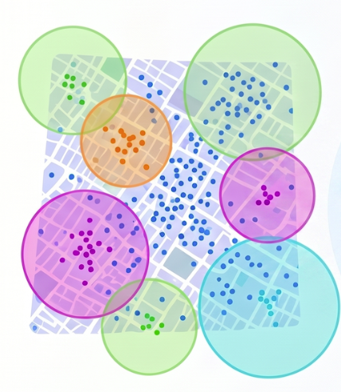

Leveraging spatial analytics in the field of public health nutrition — beyond the 
plotting of basic choropleth maps — has historically been uncommon, despite the 
well-established fact that acute malnutrition, like other diseases, exhibits 
geographical variation. Spatial cluster analytics have been utilised to explore 
the geographic variation of several public health issues [@Robin; @Eryando], 
enabling decision makers to better understand community health needs and allocate 
resources in a cost-effective manner [@gis-epi].

Programme managers have constantly been — and continue to be — confronted with the 
challenge of prioritising resources and responses to where needs are the most. 
Currently, this challenge has further deepened with the shrinking of the funding 
environment that humanitarian actors are experiencing since the beginning of 
2025, leading to the need for a revamped prioritisation strategy for available 
resources — "hyperprioritisation". 

Even before these times of hyperprioritisation, setting prioritisation without 
spatial analytics has been a challenge, with different approaches being employed 
to identify communities in need. For instance, in Mozambique, prioritisation of 
communities to be served has been based on distance. Communities living 
in remote areas are prioritised for integrated health and nutrition outreach 
activities over nearby communities, with the premise that remote communities are 
the most vulnerable for being far away from basic services available at the central 
district. 

Whilst the underlying reasoning may be logical, it is not always true due to 
the wide-range and complex-interplay of the factors that lead to acute malnutrition. 

Currently, leveraging spatial analytics to "pin-point" locations wherein there is 
an excess of acute malnutrition is becoming increasingly common, widely
accepted, and deemed both necessary and relevant. The `wowi` package is at the 
centre of this breakthrough. At the time of writing, `wowi` has been used to 
inform humanitarian situation analyses and responses across four countries: 
Somalia, South Sudan, Sudan, and Mozambique.

With the growing use of spatial cluster analysis, it is important to understand 
a few core concepts. In this sense, this article will walk you through the essence 
of spatial cluster analysis in spatial epidemiology, with an emphasis on the 
method used in `wowi`. Moreover, you will also be guided through some key 
considerations worth keeping under your belt when analysing and interpreting 
spatial clusters. Because the focus of `wowi` is currently limited to acute 
malnutrition, these considerations are put into the perspective of acute malnutrition.

## Core Concepts: Spatial Epidemiology, Spatial Clusters, Spatial Structure, Spatial Autocorrelation 

__Spatial epidemiology__ — also referred to as _disease mapping_ — focuses on 
the study of the geographical or spatial distribution of health outcomes. Data that 
exhibit a discernible pattern across geographic space are said to have a 
__spatial structure__ [@David2023]. In other words, the occurrence and magnitude 
of the outcome vary systematically across locations and are influenced by 
underlying geographical, environmental, demographic, or socio-economic conditions. 
On the other hand, data without a discernible spatial structure are said to have 
been generated by an independent random process (IRP), or that exhibit complete
spatial randomness (CSR) [@David2023].

__A spatial cluster__ is defined as a concentration of cases in a
specific geographic area that is statistically significant and differs from what 
would be expected under an IRP or CSR [@Aldstadt2010]. 
There are several methods that can be leveraged to glean the underlying spatial structure 
hidden in the data. These are grouped into two major buckets: (1) _global_ or 
_general_ tests and (2) _local_ tests, all grounded on the spatial autocorrelation. 

__Spatial autocorrelation__ is a method that is employed to 
measure whether spatial patterns exist in data [@statstest-clustering; @David2023].
Essentially, it measures the variation of a variable — say malaria — by taking an 
observation from the malaria variable and seeing how similar or different it is 
compared to other observations within a given neighbourhood, and quantifies the 
extent of it. Global tests only provide an overall assessment as to whether there
is a spatial structure in the data and the degree of it [@David2023]; global tests 
do not address the _where_ question. This task is reserved for the local tests. 
Local tests are designed to identify specific areas wherein spatial clustering occurs. 
They provide insights into the spatial patterns and help pin-point areas of concern, 
by showing localised clusters with statistically significant high values — 
__hot spots__ — and low values — __cold spots__ [@focused-clustering]. 

:::{.callout-note title="Analysis workflow of global and local tests"}
The workflow is that you first undertake a global test to ascertain whether your 
data exhibits a discernible spatial structure. If true, then you proceed to 
leverage local tests to glean the spatial structure therein. 
:::

There are several statistical methods to that. `wowi` leverages __scan tests__.
Scan tests are local tests.

## How do Scan Tests Work? 

The workflow of scan tests involves identifying spatial clusters by scanning 
through the data and evaluating the likelihood of observing the data under a null
hypothesis of no spatial clustering. In other words, scan tests impose many 
scanning windows of variable sizes over an area of interest, and calculates 
the likelihood of the observed data within that window under the null hypothesis 
of IRP or CSR. This process is repeated across the entire dataset to identify 
locations where the observed data significantly deviates from the null hypothesis, 
indicating potential spatial clusters [@satscan; @scan-tests]. Along with it, scan
test results provide information on the size of the detected clusters in kilometres, 
the magnitude of them - relative risk ratio, proportion of cases, and the 
statistically significance of them. 

To build intuition for how this test works, the following visual was generated 
using Gemini Notebook.

::: {#fig-scantests}

 

A simplified illustration of how scan tests work, intended only to convey a 
general idea rather than technical precision. Generated using Gemini Notebook.
:::

:::{#imp-causes .callout-important}
## Spatial cluster analysis identifies patterns, not causes or drivers

It is noteworthy that cluster analyses help you unveil patterns hidden in your data; 
they do not explain why they exist or occur. That means that once unveiled, further 
investigation is needed to understand the underlying reasons.

:::

## Core considerations worth keeping under your belt when interpreting cluster analysis results 

There are several core considerations to bear in mind before undertaking a cluster
analysis as well as at the stage of interpreting results derived from it. The 
former revolves around the methodology through which data was derived, and the latter 
around their interpretability. These are expanded below, and put into 
the perspective of acute malnutrition. 

### Sound sampling design for the unit of analysis {#sec-methodology}

According to @intepret-clusters, interpretation of cluster findings should be 
premised on the underlying methodology leveraged to derive data. In other words,
the designed sampling should be representative of the underlying study population.

On the matter of acute malnutrition, cluster analysis should only be undertaken 
leveraging population-based assessments. These can be sample-based representative
surveys or exhaustive surveys or even exhaustive screenings at the unit of analysis.
As known, these methods ensure that the representativeness of the underlying 
study population is present. Otherwise, if the scope of the underlying assessment 
is constrained to a subset of the population, perhaps purposively selected, say
one admin 3 rather than a sampling frame of all admin 3s, then the results 
should be applied to that admin 3 only from where data was derived. 

:::{.callout-note title="Definition of unit of analysis for the purpose of this article"}
As the objective of cluster analysis is to identify spatial patterns and inform 
targeted interventions, for the purpose of this article, a unit of analysis is the 
administrative unit for which programme managers design interventions to address 
malnutrition, typically admin level 3 (for example, districts in Somalia, 
localities in Sudan, and counties in South Sudan).
:::

Large-scale surveys — those conducted above the admin unit 3, aggregating 
several smaller units, such as livelihood-zone-based surveys — can also be 
leveraged for cluster analysis, and clusters can be detected within them. It 
is noteworthy, however, that the detected clusters may not be as insightful 
for an effective programme response or targeting as a small-scale survey — 
say, a district-specific survey — would be in unveiling within-district 
variation in an effective manner. 

To put this into perspective, in surveys like SMART, primary sampling units (PSUs) 
are selected based on probability proportional to size of the underlying study 
population [@smart2017]. This means that in large-scale surveys, districts 
densely populated would have more PSUs than less-densely populated. 
On the other hand, in small-scale surveys, high-densely populated
communities would have more PSUs. In these two scenarios, the spatial clusters 
would be much more insightful for programming in the latter scenario than in the 
former, although the former is also useful to know which districts are more vulnerable. 
What is lacking in the former scenario is the zoom-in to expose the within-district 
mapping that is much more relevant for programming.

Cluster analysis can also be leveraged in surveys derived from spatial sampling 
methods.

### Accurate case ascertainment {#sec-case_ascertainment}

Accurate case ascertainment is a critical consideration to bear in mind as they 
can impact the interpretation of cluster findings. It revolves around whether cases
are correctly diagnosed or defined, as well as the extent to which there might be 
misdiagnosis in the data [@intepret-clusters]. The gist of this is that as 
an analyst, you must be sure that your data is free of misdiagnosis beforehand. That 
way, the spatial structure in your data is genuine rather than an artifact of 
misdiagnosis. One example of how the spatial structure in the data can be an artifact 
of misdiagnosis is when survey teams make measurement errors in a systematic 
manner across the areas in which they are assigned to survey. As teams are 
usually assigned survey clusters (PSUs) that are geographically close to each other
— because it is practical and reduces operational costs than otherwise — systematic 
errors would hence be geographically bound, thereby creating a spatially structured
bias. A case in point for this is when survey teams misdiagnose bilateral 
pitting oedema. This would yield too many cases of acute malnutrition across the 
PSUs they surveyed. 

Fortunately for acute malnutrition, thanks to the SMART Initiative, this and many
other data-quality-related issues can be checked by leveraging the SMART plausibility 
check test suite [@smart2017]. 

:::{.callout-note title="Useful resource for plausibility checks in R"}
In R, you can implement the SMART plausibility check test suite by leveraging the 
[`mwana`](https://mphimo.github.io/mwana/) package [@mwana]
:::

### Incomplete reporting or missing values {#sec-missing_values}

Incomplete reporting or the presence of missing values of both spatial and 
non-spatial variables in your data can affect the cluster analysis by reducing the 
power to detect true clusters [@intepret-clusters]. As the missing values cannot 
be imputed in a logical way [@David2023], they are dropped. This means that 
when the extent of the missing values is high, they give rise to the finding of 
false clusters. On the matter of spatial variables, incomplete reporting of global
positioning system (GPS) coordinates is extremely common in surveys. Thus, it is 
a good practice to undertake an exploratory data analysis (EDA) of your data to 
inspect for such problems. 

:::{.callout-note title="A case in point on how missing-value problem can affect the analysis"}
Results from an EDA undertaken as part of a spatial data analysis of 10 districts
of a country in East Africa found a remarkably high percentage of missing values 
of latitude and longitude coordinates in the dataset. Results ranged between 3% and 54%. 
All rows with missing latitude and longitude coordinates were excluded from the 
analysis. Along with it, 71 cases of acute malnutrition were consequently
dropped. As evident, that affected the representation of the true geographical 
reality.

:::

It is noteworthy that before `wowi` pipes the input data to the downstream 
spatial scan model, it first filters out all missing values in latitude and 
longitude. 

### Location uncertainty during the capture of geographical coordinates {#sec-horizonal_error}

Besides the missing-value problem, location uncertainty of GPS coordinates 
is another problem to have under consideration. This is probably the most 
overlooked problem during data collection. Survey teams may capture GPS 
coordinates with a wide precision and accuracy, hence increasing the location 
uncertainty. 

Location uncertainty impacts disease clusters by introducing bias into the 
spatial relationship between point features [@gis-epi] and by decreasing the 
statistical power [@intepret-clusters], thereby resulting in flawed findings and
poor public health decisions [@Jacquez2012]. In simple terms, it affects the 
representation of the variable's observations to its actual geographical 
reality — where they actually occur. For instance, a child in the dataset may be 
assigned to a wrong geographical location from where he/she actually resides. 

:::{.callout-note}
## A case in point on how location-uncertainty problem affects us
If you call Uber or any other app-based transportation services and you do not 
let your mobile device read your geographical location with good precision 
before you confirm the request, the distance between your device's calculated 
map position and your actual physical position on the earth's surface — 
_horizontal error_ — may be large. That location may lead the driver to a different 
location from where you are.
:::

As known, all measurements contain error due to the inevitable imprecision 
associated with the process of taking measurements. Nonetheless, they can be 
minimised with adequate training and close monitoring during data collection as 
suggested below.  

  + __Training__: nowadays, almost all surveys leverage mobile devices for data 
  collection. In this sense, enumerators should be trained to ensure an optimal 
  accuracy when capturing the GPS coordinates. Doing this would simultaneously 
  address the missing-value problem discussed above. 
  + __Data quality checks__: in addition to training, the usual daily (or periodic) 
  data quality checks should also include checking the completeness of GPS 
  coordinates, as well as checking the mean, median, minimum, and maximum values 
  of the accuracy associated to a pair of latitude and longitude coordinates. 
  Ideally, these checks should be split by teams to better assess the quality. 

:::{.callout-important title="What is the recommended width of GPS accuracy?"}
While it is not clear what constitutes the optimal recommended GPS accuracy 
(horizontal error), the rule of thumb is that it should be smallest possible, 
ideally under 10 metres.
:::

### Small numbers problem 

Small-number problem refers to the intrinsic variance instability of rates 
due to the population density variability across the study area, whereby the variance 
increases as the denominator decreases. This problem can lead to the 
identification of spurious results. In some spatial analysis methods, it is 
recommended to correct for this problem by applying rate smoothing approaches that 
improve the precision of crude rates or proportions by borrowing strength from 
other observations [@intepret-clusters; @geoda].

Some scan test models take input data in the form of rates and others do not. The model 
leveraged in `wowi` — Bernoulli model — does not. The model is free of the 
small-number problem. It takes a binary variable for each pair of latitude and longitude 
coordinates, with cases represented as "1" and non-cases (controls) as "0" [@satscan]. 

### Are the detected clusters real? 

It is worth reflecting on the extent to which the detected clusters are truly
real clusters. @intepret-clusters adverts to the fact that identification of statistically 
significant clusters may not necessarily mean that a disease cluster is real in the 
sense that it reflects a true underlying excess of risk. This premise is grounded 
on the problems that we have already discussed above in the previous sections, 
as well as other issues discussed below. 

According to @intepret-clusters, false clusters lack plausible biological 
explanation. True clusters comprise statistically significant excess as 
well as common and plausible biological explanation for their occurrence. Hence, 
both statistical and biological plausibility must be taken into consideration 
when ascertaining whether a cluster is real. 

In acute malnutrition, as discussed in @sec-case_ascertainment, fortunately, this
is comprehensively addressed in the SMART methodology through its rigorous 
data collection methodology and data quality test suite that provide an understanding 
of the reliability of the data [@smart2017]. 
Moreover, it also provides results on design effect (DEFF) and index of dispersion 
(ID) [@smart2017]. These non-spatial statistics already give an indication as to 
whether the data exhibits a heterogeneous distribution of cases across the survey 
area or not, or whether there is statistically significant evidence that cases 
are clumped into certain pockets of acute malnutrition. The former is addressed by the 
DEFF statistics and the latter by the ID. 

On the DEFF, the Integrated Food Security Phase Classification (IPC) established 
that when a survey exhibits a DEFF that is greater than or equal to 1.3, there 
is evidence that acute malnutrition follows a heterogeneous distribution across 
the survey area [@ipcmanual]. To the best of our knowledge, as of the writing, 
`wowi` has been leveraged only in surveys whose DEFF was at or above the IPC threshold. 

:::{.callout-note title="Useful resource to estimate ID in R"}
In R, you can calculate the ID or Green's Index statistic leveraging the 
[`nipnTK`](https://nutriverse.io/nipnTK/reference/greensIndex.html) [@nipnTK].
:::

### What do they mean? 

As discussed in @imp-causes, cluster analyses do not explain what drives the 
spatial structure in the data. This is a task reserved to you. Once the spatial 
clusters have been detected, analysts should strive as much as possible to 
understand the why. This could encompass undertaking: 

  + __Further EDA__: this could include descriptive statistics of key indicators 
  in the data that are known to drive acute malnutrition, such as disease, 
  food security, WASH, etc. This process should leverage data from the same survey 
  where applicable, and constrained to the survey PSUs that fall inside the 
  spatial cluster under analysis. Furthermore, This could also be extended to 
  assessing the recent trend in admission of acute malnutrition derived from the 
  catchment areas that serve the concerned PSUs.

  + __Qualitative assessment__: In addition to the quantitative EDA, the qualitative
  assessment could provide additional insights as to why. Whilst the former approach can 
  be undertaken right away, the qualitative assessment should ideally be pursued 
  alongside a response. 

 

## References