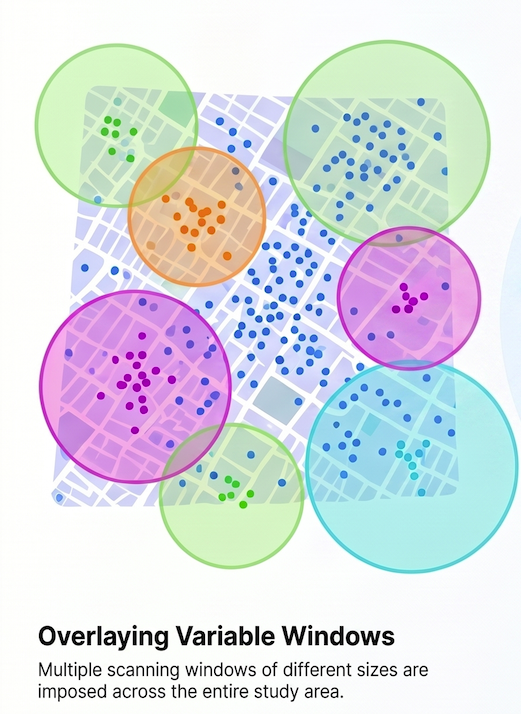

Leveraging spatial analytics in the field of public health nutrition—beyond the 
plotting of basic choropleth maps—has historically been uncommon, despite the 
well-established fact that acute malnutrition, like other diseases, exhibits 
geographical variation. Today, however, programme managers face the challenge of
hyperprioritising resources within a shrinking operational environment. 
Consequently, leveraging these analytics is becoming increasingly common, widely
accepted, and deemed both necessary and relevant.

Spatial cluster analytics have been utilised to explore the geographic variation
of several public health issues [@Robin; @Eryando], enabling policymakers to 
better understand community health needs and allocate resources in a cost-effective
manner [@gis-epi].

The `wowi` package is at the centre of this breakthrough. At the time of writing, 
`wowi` has been used to inform humanitarian situation analyses and responses 
across four countries: Somalia, South Sudan, Sudan, and Mozambique.

With the growing use of spatial cluster analysis, it is important to understand 
a few core concepts. Therefore, this article will walk you through the essence 
of spatial cluster analysis in spatial epidemiology, with an emphasis on the 
methods used in `wowi`. Moreover, you will also be guided through some key 
considerations worth keeping under your belt when analyzing and interpreting 
spatial clusters. Because the focus of `wowi` is currently limited to acute 
malnutrition, these considerations are put into the perspective of acute malnutrition.

## Key Concepts: Spatial Epiedemiology, Spatial Clusters, Spatial Structure, Spatial Autocorrelation 

__Spatial epidemiology__ - also referred to as _disease mapping_ - focuses on 
studying the geographical or spatial distribution of health outcomes. Data that 
exhibits a discernible pattern across geographic space are said to have a 
__spatial structure__ [@David2023]. In other words, the ocurrance and magnitude 
of the outcome vary systematically across locations and are influenced by 
underlying geographical, environmental, demographic, or socioeconomic conditions. 
On the other hand, data without a discernible spatial structure are said to have 
been generated by an independent random process (IRP), or that it exhibts complete
spatial randomness (CSR) [@David2023].

__Spatial cluster__ or _clustering_ is defined as a concentration of cases in a
specific geographic area that is statistically significant and differs from what 
would be expected under an IRP or CSR [ADD A REFERENCE]. 
There are several that can be leveraged to glean the underlying spatial structure 
hidden in the data. These are grouped into two major buckets: (1) _global_ or 
_general_ tests and (2) _local_ tests, all grounded on the spatial autocorrelation. 

__Spatial autocorrelation__ is an spatial analysis method that is employed to 
measure whether spatial patterns exist in a data [@statstest-clustering; @David2023].
Essentially, it measures the variation of a variable - say malaria - by taking an 
observation from the malaria variable and seeing how similar or different it is 
compared to other observations within a given neighbourhood, and quantifies the 
extent of it. Global tests only provide an overall assessment as to whether there
is a spatial structure in the data and the degree of it [@David2023]. Global tests 
do not address the _where_ question. This job is reserved for the local tests. 
Local tests are designed to identify specific areas where spatial clustering occurs. 
They provide insights into the spatial patterns and help pinpoint areas of concern, 
by showing localised clusters with statisitically significant high values - 
__hot spots__ - and low values - __cold spots__ [@focused-clustering]. 

:::{.callout-note}
The workflow is that you first undertake a global test to ascertain whether your 
data exhibits a discernible spatial structure. If true, then you proceed to 
leverage local tests to glean the spatial structure out. 
:::

There are several statistical methods to that. `wowi` leverages __scan tests__.
Scan tests are local tests.

## How do Scan Tests Work? 

The workflow of scan tests involves identifying spatial clusters by scanning 
through the data and evaluating the likelihood of observing the data under a null
hypothesis of no spatial clustering. In other words, scan tests imposes many 
scanning windows of variable sizes over an area of interest, and calculates 
the likelihood of the observed data within that window under the null hypothesis 
of IRP or CSR. This process is repeated across the entire dataset to identify 
locations where the observed data significantly deviates from the null hypothesis, 
indicating potential spatial clusters [@satscan; @scan-tests]. Along with it, scan
test results provide information on the size of the detected clusters in kilometres, 
the magnitude of them - relative risk ratio, proportion of cases, and the 
statistically significance of them. 

In order to elucidate you how this test works, I asked Microsoft Copilot's assistance
to visualise this. Hopefully this will give you a clue to grasp scan tests. 
See Figure xx 

 

:::{.callout-important}
## Spatial cluster analysis identify patterns, not causes

It is noteworthy that cluster analyses help you unveil patterns hidden in your data; 
They do not explain why they exist. That means that once unveilled, further 
investigation is needed to understand the underlying reasons.

:::

## Key considerations worth keeping under your belt when interpreting local cluster analysis results 

There are several key considerations to bear in mind before undertaking a cluster
analysis as well as at the stage of interpreting results derived from it. The 
former revolves around the process through which data was derived from - 
representativeness of the area of interest, and quality of data. The latter 
revolves around their interpretability. These are expanded below, and put into 
perspective of acute malnutrition. 

### Sound sampling design for the unit of analysis

According to @intepret-clusters, interpretation of a cluster findings should be 
premissed on the underlying methodology leveraged to derive data. In other words,
the designed sampling should be representative of the underlying study population.

On the matter of acute malnutrition, cluster analysis should only be undertaken 
leveraging population-based assessments. These can be sample-based representative
surveys or exhaustive surveys or even exhaustive screenings at the unit of analysis.
As known, these methods ensure that the representativeness of the underlying 
study population is present. Otherwise, if the scope of the underlying assessment 
is constrained to a subset of population, perhaps purposively selected, say
one admin 3 rather than a sampling frame of all admin 3's, then the results 
should also be only applied to that admin 3 only. 

:::{.callout-note}
As the objective of cluster analysis is to identify spatial patterns and inform 
targeted interventions, for the purpose of this article, a unit of analysis is the 
administrative unit for which programme managers design interventions to address 
malnutrition, typically admin level 3 (districts in Somalia, localities in Sudan,
and counties in South Sudan).
:::

For large-scale surveys - those conducted above the admin unit 3, aggregating 
several of them, such as livelihood-zone-based surveys, while they can also be 
leveraged for cluster analysis and clusters be detected, it is noteworthy that 
the detected clusters may not be as insightful for an effective programme 
response or targetting as small-scale survey - say district-specific survey - 
would in unveiling within-district variation in an effective manner. 

To put this into perspective, in surveys like SMART, primary sampling units (PSUs) 
are selected based on probability proportional to size of underlying study 
population [@smart2017]. This means that districts densely populated would have more PSUs than
less-densely populated. In the case of small-scale surveys, high-densely populated
communities would have more PSUs. In these two scenarios, the clusters would be 
much more insightful for programming in the latter scenario than in the former, 
although the former is also useful to know which districts are more vulnerable. 
What lacks in the former scenario is the zoom-in to expose the within-district 
mapping that is much more relevant for programming.

Cluster analysis could also be leveraged in surveys derived from spatial sampling 
methods.

### Accurate case ascertainment 

Accurate case ascertainement is a critical consideration to bear in mind as they 
can impact the interpreation of cluster findings. It revolves around whether cases
correctly diagnosed or defined, as well as the extent to which there might be 
misdiagnosis in the data [@intepret-clusters]. The gist of this is that as 
analyst, you must be sure that your data is free of misdiagnosis beforehand. That 
way, the spatial structure in your data is genuine rather than an artifact of 
misdiagnosis. One example on how the spatial structure in a data can be an artifact 
of misdiagnosis is when survey teams commit measurement errors in a systematic 
manner accross the areas in which they are assigned to survey. As teams are 
usually assigned survey clusters (PSUs) that are geographically close to each other
- because it is practical and reduces operational costs than otherwise - systematic 
errors would hence be geographically bound, thereby creating a spatially structured
bias. A case in point to this is when survey teams misdiagnoses billateral 
pitting oedema. This would yield too many cases of acute malnutrition across the 
PSUs they surveyd. 

Fortunately for acute malnutrition, thanks to the SMART Initiative, this and many
other data-quality-related issues can be checked by leveraging the SMART plausbility 
check test suite [@smart2017]. 

:::{.callout-note}
In R, you can implement the SMART plausibility check test suite leveraging the 
[`mwana`](https://mphimo.github.io/mwana/) package [@mwana]
:::

### Incomplete reporting or missing values 

Incomplete reporting or the presence of missing values of both spatial and 
non-spatial variables in your data can affect the cluster analysis by reducing the 
power to detect true clusters [@intepret-clusters]. As the missing values cannot 
be imputed in logical way [@David2023], they are dropped out. This means that 
when the extent of the missing values high, they give a rise to the finding of 
false clusters. 

Incomplete reporting of global positioning system (GPS) coordinates is extremely 
common in surveys. Thus, it is a good practice to undertake an exploratory data 
analysis (EDA) of your data to inspect for such problems. 

:::{.callout-note}
Results from an EDA undertaken as part of a spatial data analysis of 10 districts
of a country in East Africa found a remarkably high percentage of missing values 
of latitude and longitude coordinates. Result ranged between 3% and 54%. 
All rows with missing latitude and longitude coordinates were excluded from the 
analysis. Along with it, 71 cases of acute malnutrition were consequently d
dropped. As evident, that affected the representation of the true geographical 
reality.
:::

It is noteworthy that before `wowi` pipes the input data to the downstream 
spatial scan model, it first filters out all missing values in latitude and 
longitude. 

### Location uncertainty during the capture of geographical coordinates 

Besides the missing-value problem, location uncertainty of the GPS coordinates 
is another problem to have under consideration. This is probably the most 
underlooked problem during data collection. Survey teams may capture the GPS 
coordinates with a wide precision and accuracy, hence increasing the location 
uncertainty. 

Location uncertainty impacts disease cluster by introducing bias into the 
spatial relationship between point features [@gis-epi] and by decreasing the 
staistical power [ @intepret-clusters], result in flawed findings and poor 
public health decision [@Jacquez2012]. In simple terms, it affects the 
representation of the variable's observations to its actual geographical 
reality. For instance, a child in the dataset may be assigned to a wrong 
geographical location than where actually resides. 

:::{.callout-note}
If you call Uber or any other app-based transportation services and you do not 
let your mobile device read your greographical location with good precision 
before you confirm the request, that location may lead the driver to a different 
location that where you are. That is because there was a great uncertainty 
associated to your location. That is how the spatial relationships between gets 
affected.
:::

As known, all measurements contain error due to the innevitable imprecision 
associated with the process of taking measurements. Nonetheless, they can be 
minimised with adequate training and close supervision during data collection.  

  + __Training__: nowadays, almost all surveys leverage mobile devices for data 
  collection. In this sense, enumerators should be trained to ensure an optimal 
  accuracy when capturing true GPS coordinates at the household level. Doing this 
  would simultaneously address the missing-value problem discussed above. 
  + __Data quality checks__: in addition to training, the usual daily (or periodic) 
  data quality checks should also include checking the completness of GPS 
  coordinates, checking the mean, minimum and maximum values of the accuracy 
  associated to a pair of latitude and longitude coordinates. Ideally, these 
  checks should split by teams. 

### Are the detected clusters real?

### What do they mean?

### Is there an excess? 

😂